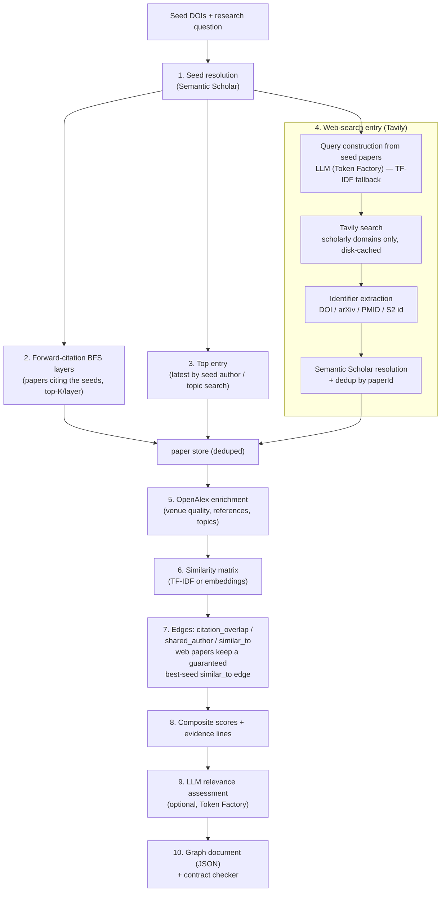

# Scinapse

Scinapse is a research-paper discovery app that turns a research question and a collection of seed DOIs into a ranked, traceable graph of related publications. It combines citation expansion, seed-derived Tavily web search, metadata enrichment, similarity scoring, optional Nebius Token Factory assessments, and an interactive React explorer.

This project was created as part of a research and AI application competition.

<br />

## The problem

Researchers often have a collection of papers relevant to their topic but struggle to find more through keyword searches alone. Scinapse takes that existing collection as a starting point and discovers additional relevant publications.

## The challenge

The app helps a researcher move from known papers to a ranked, traceable set of new ones. It shows useful metadata, relationship evidence, source links, warnings, and explanations of why a paper may be relevant.

## How Scinapse works

```text
Research question + 1–10 seed DOIs
                 |
                 v
        FastAPI research service
                 |
                 v
 Semantic Scholar citation discovery
                 |
                 v
 Tavily scholarly web search (optional)
                 |
                 v
      OpenAlex metadata enrichment
                 |
                 v
 Similarity + citation + author edges
                 |
                 v
 Optional Nebius assessments/embeddings
                 |
                 v
         Validated graph JSON
                 |
                 v
          React graph explorer
```

The backend runs one background research job at a time. The frontend submits an exploration, polls its progress, and loads the validated graph when the job completes. The service exposes health, job status, graph, and interactive API documentation endpoints.

## Retrieval flow



Web-search budget defaults: 3 queries × top 8 results, up to 6 resolved papers pinned into the top layer (`entry="web"`); `--no-websearch` disables the step, and it degrades to a warning when `TAVILY_API_KEY` is missing. See `AGENTS.md` for the full module map and API constraints.

## Competition approaches

Scinapse combines several of the suggested approaches:

- Follow citation and reference networks to find papers connected to multiple seed publications.
- Derive search queries from the seed papers (LLM with a deterministic TF-IDF fallback) and use Tavily web search restricted to scholarly domains to reach papers outside the citation graph.
- Use TF-IDF similarity by default, with optional embeddings from Nebius Token Factory.
- Use Nebius Token Factory for structured relevance assessment, ranking support, and explanations.
- Combine retrieval, ranking, evidence inspection, filters, and human review in an interactive workflow.

The current pipeline uses Semantic Scholar and OpenAlex for discovery and enrichment, and Tavily for seed-derived scholarly web search.

## Services and APIs

- [Nebius Token Factory](https://hackathons.techeurope.io/start-here/setup.md) — OpenAI-compatible LLM and embedding inference.
- [Tavily](https://www.tavily.com/) — seed-derived scholarly web search that augments citation discovery.
- [Semantic Scholar](https://www.semanticscholar.org/product/api) — seed resolution and citation discovery.
- [OpenAlex](https://docs.openalex.org/) — paper, author, venue, topic, and reference metadata.
- FastAPI — local HTTP service for asynchronous research jobs.

The pipeline caches HTTP responses in `.scinapse_cache/` and applies pacing and retry behavior for provider rate limits. Secrets are loaded from `.env` and are not committed.

## Configuration

Copy the example environment file before running the backend:

```sh
cp .env.example .env
```

Available settings:

- `NEBIUS_API_KEY` enables relevance assessments and can enable embeddings when an embedding model is selected.
- `TAVILY_API_KEY` enables the Tavily web-search entry; without it the build continues with a warning.
- `S2_API_KEY` is optional and can improve Semantic Scholar rate limits.
- `SCINAPSE_SMOKE=1` uses the quick local profile by default; set it to `0` for standard expansion.
- `SCINAPSE_NO_LLM=1` explicitly skips LLM assessments.
- `SCINAPSE_MAILTO` optionally identifies requests for provider polite pools.

Without a Nebius key, discovery still works and relevance fields remain unassessed.

## Run both services locally

Requirements: Python 3.10+, `uv`, and Node.js 22.18+ or 24+.

Install Python dependencies and start the backend from the repository root:

```sh
uv sync --dev
uv run uvicorn scinapse.api:app --host 127.0.0.1 --port 8000
```

In a second terminal, start the frontend:

```sh
cd frontend
npm ci
npm run dev
```

Open <http://127.0.0.1:5173>. Vite forwards `/api` to the backend on port 8000. Backend health is available at <http://127.0.0.1:8000/api/health>, and interactive API documentation is available at <http://127.0.0.1:8000/docs>.

## API flow

The frontend accepts a research question between 3 and 2,000 characters and one to ten seed DOIs. DOI URLs are normalized and duplicate seeds are removed.

```text
POST /api/explorations
        |
        v 202 Accepted + job id
GET /api/explorations/{id}
        |
        v poll queued/running/completed/failed status
GET /api/explorations/{id}/graph
        |
        v validated graph used by the explorer
```

Only one job runs at a time in this local implementation, and up to 20 completed jobs are retained in memory. Restarting the backend clears those sessions. A persistent queue and shared job store are needed before scaling beyond a single process.

## Run the CLI pipeline

The original CLI remains available for direct graph generation and validation:

```sh
# Build a small, inexpensive graph
uv run scinapse build \
  --seed 10.1038/s41586-020-2649-2 \
  --question "How can machine learning improve scientific discovery?" \
  --out graph.json \
  --smoke

# Skip Nebius assessments
uv run scinapse build \
  --seed 10.1038/s41586-020-2649-2 \
  --question "How can machine learning improve scientific discovery?" \
  --out graph.json \
  --smoke \
  --no-llm

# More web-searched papers: extra queries and a higher pin cap
uv run scinapse build \
  --seed 10.1038/s41586-020-2649-2 \
  --question "How can machine learning improve scientific discovery?" \
  --out graph.json \
  --websearch-queries 5 --websearch-pinned 12

# Validate a generated graph
uv run scinapse check graph.json
```

The build command also supports repeated `--seed`, `--layers`, `--top-k`, `--top-entry-n`, `--recent-min-year`, `--cache-dir`, `--chat-model`, `--embed-model`, `--no-llm`, `--no-websearch`, `--websearch-queries`, `--websearch-pinned`, and `--strict` options.

## Run tests

The Python tests are network-free:

```sh
uv run pytest
```

Frontend tests and the production build run inside `frontend`:

```sh
cd frontend
npm test
npm run build
```

## Run the frontend with Docker

The image packages the static frontend and bundled example graph. It does not include the Python backend or a reverse proxy for live `/api` requests.

```sh
docker build -f frontend/Dockerfile -t scinapse-frontend .
docker run --rm -p 8080:80 scinapse-frontend
```

Open <http://localhost:8080>. Rebuild after changing the bundled `graph.json` example. For live search, run the FastAPI service separately and place an `/api` reverse proxy in front of it.

## Repository structure

```text
src/scinapse/             Python pipeline, FastAPI service, CLI, and graph checker
frontend/                 React/Vite explorer, API client, and Dockerfile
tests/                    Network-free Python API and contract tests
graph.json                Bundled frontend example graph
sample_response.json      Graph contract example
sample_response.large.json Legacy/large sample data used by earlier frontend builds
.env.example              Backend configuration template
```

## Deliverable and limitations

The competition deliverable is a working research discovery experience with a public source repository, setup instructions, documented APIs and tools, and enough technical detail for jury evaluation. This repository includes the graph contract, checker, backend API, frontend interaction documentation, Docker packaging, and tests.

The bundled graph uses fictional demo identities and links. The local server keeps jobs in memory and uses one worker to respect provider pacing. A production deployment should use a persistent job queue, durable result storage, hosted backend/frontend separation, and deployment-managed API credentials.
